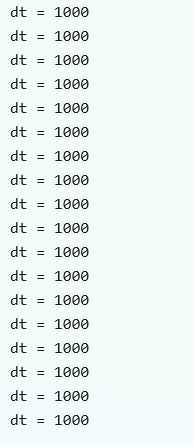
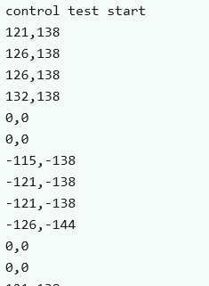

# 调试记录

这个项目从零开始，坑没少踩。按时间顺序记下来，大部分都是不起眼的小问题，但每个都值得记一笔——说不定哪天又踩一遍。

## 8.16
1. 问题：好一阵没碰 STM32，重新拿出 C8T6 写个点 PC13 的程序，没反应。
   排查：程序看着没问题，接线也正常，换别的程序照样不行。随手点了下 debug，居然有现象了。
   原因：太久没用 Keil，忘了 download，一直在 rebuild——压根没烧进去。
   解决：记得烧录（download 之后 run）。

## 8.17
2. 问题：VSCode 里 Keil 插件用不了。
   排查：检查 UV4 路径、换工程文件夹都没用。问别人才知道：要在"资源管理器大纲"下的"Keil UVision Project"目录里打开工程文件。
   原因：一直在操作 VSCode 自己打开的那个文件，不是真正的工程。
   解决：在资源管理器大纲里找到 Keil UVision Project 目录，从那里打开工程。

3. 问题：Keil Assistant 一点 build 就报 bash: syntax error near unexpected token '&'。
   排查：看终端路径发现是 Git Bash 在执行命令，但 Keil Assistant 生成的是 PowerShell 语法（那个 & 是调用运算符）。
   原因：VSCode 默认终端设成了 Git Bash，两边语法对不上。
   解决：把默认终端改成 PowerShell。

4. 问题：下载报 ST-LINK USB communication error。
   排查：设备管理器能看到 ST-Link，Keil Settings 里也能看到序列号和固件版本，说明 USB 和驱动没问题；但 SW Device 显示 No target connected。检查 ioc 里 PA13/PA14 是 Serial_Wire 没被占用，板子电源亮着，SWDIO/SWCLK/GND/3.3V 接线也没错。时钟降到 100kHz、用 under Reset 模式按复位键，还是不行。最后换了根杜邦线就好了。
   原因：杜邦线内部断了，外表看不出来。
   解决：换杜邦线。

## 8.19
5. 问题：上电没反应，电机驱动板不亮。
   排查：看芯片外观没发黑，用万用表蜂鸣档量 VM 和 GND，响了——短路。
   原因：不小心把供电反接了，驱动板被击穿。
   解决：重新买了一块。

## 8.21
6. 问题：低 PWM 下左轮几乎不动，右轮正常。
   排查：先排除代码，Motor_SetSpeed 两个电机逻辑对称，没写错。查接线，AIN1/AIN2/PWMA 对应左轮，BIN1/BIN2/PWMB 对应右轮，也对。悬空测试给两个电机相同 PWM，左轮还是慢。再把左右电机线在驱动板端互换，原来慢的照样慢。
   原因：直流减速电机个体差异，死区不同——左轮 PWM>600 才启动，右轮 PWM>400 就启动，给 500 时左轮卡着不动。
   解决：这是正常现象，不是 bug。开环给 PWM>1500；加了编码器闭环 PID 后，PID 发现左轮没到目标转速会自动加大左轮 PWM，差异被自动补偿。

## 8.23
7. 问题：灰度模块数据不对，串口打印 8 路和实际不符，挡第一个灯结果第五个亮，变成 51372648。
   排查：查代码、怀疑接线，发现 AD0 和 AD2 接反了；改过来还是不对，1 和 5 是反的。再查代码，Gray_ReadChannel 里的延时被注释掉了，切换通道后没等稳定就读。
   原因：切换通道后没延时，读取不稳定。
   解决：保留切换后的 50us 延时。

## 8.24
8. 问题：改了主循环后报 function definition is not allowed here。
   排查：检查代码，main() 的 {} 没闭合，少了个 }。
   原因：main 的右括号没封闭，把 while 后面的函数都包进 main 里了。
   解决：while 结束后补一个 }。

9. 问题：循迹一启动就往右转。
   排查：试了好多次都往右，发现是灰度模块 8 号灯一直常亮。把模块放白纸上测，8 号灯灭了。
   原因：家里地板不够白，跟黑线区分不开。
   解决：暂时没解——这个模块不能调阈值（买的时候没注意），打算去学校用那边的场地。

## 8.25
10. 问题：重组小车后左轮转、右轮不转。
    排查：左轮正常说明供电没问题。查右轮 BIN1/BIN2/PWMB 引脚正常，代码里左右轮同时 set compare 也没问题。后来看到右轮 BIN 接的 PB0、PB1 在板子末尾，想到换了新面包板可能没插紧。
    原因：板子没插稳。
    解决：重新插稳。

11. 问题：加编码器后速度出现负值，方向反了。
    排查：串口看编码器计数，正转时计数是负的。查接线发现左编码器 A、B 相接反了（A 接到 B，B 接到 A）。
    原因：编码器 A/B 相接反，计数方向反。
    解决：对调 A/B（A=PA1、B=PA0），方向恢复。

## 8.27
12. 问题：速度环 Kp=50 时稳定在 150，但位置环一变速就剧烈震荡。
    排查：位置环给左右不同目标后，慢速那侧轮子剧烈震荡、转速乱跳。把 Kp 从 50 降到 15，再调 Ki 才稳定。
    原因：Kp 对变速/低速场景偏大。低速时编码器脉冲少，量化误差被放大，PID 就震荡了。
    解决：Kp 降到 15，Ki 调到 1。

13. 问题：速度环稳定后高速/低速轮存在静差（实际低于目标）。
    排查：纯 P 控制有稳态误差——PWM=Kp*err，要维持转速就得有非零 err。
    原因：P 控制固有稳态误差。
    解决：加大 Ki 用积分项消除，静差没了。

14. 问题：VOFA+ 只识别到一个通道，应该左右两个。
    排查：先 printf 带名字 left:%d,right:%d，只出一个通道；改成纯 CSV %d,%d\n 后正常出两个。
    原因：VOFA+ FireWater 要纯 CSV（逗号分隔、不带标签），带标签会被解析成一个通道。
    解决：printf 用 %d,%d\n 纯 CSV 格式。

15. 问题：printf 报 implicitly declaring library function。
    排查：app.c 里用了 printf，没 include stdio.h。
    原因：缺 stdio.h。
    解决：app.c 里加 include stdio.h。

## 8.28
16. 问题：OLED 上电不亮。
    排查：代码没问题，检查硬件接线时发现接错了电压。断电后用万用表量 OLED 模块 GND/VCC 之间电阻，是短路。
    原因：OLED 模块烧坏。
    解决：买块新的。

## 8.31
17. 问题：改成状态机后，全黑的时候右轮高速旋转。
    排查：一开始状态机在 RUN 里先跑 App_Position_Control 再判全黑/全白，结果全黑时 pos=-9999 被当成"偏左极大"，位置环算出右轮目标=200 就疯转。
    原因：全黑/全白时 pos 是 -9999/9999，不能当正常偏差算差速。
    解决：改成 RUN 里先判 pos，全黑/全白直接切状态，只有正常压线才跑位置环。改后全黑/全白时轮子停。

18. 问题：没按按键，上电就转，轮子有时疯转有时慢转。
    排查：先怀疑状态机/初始状态问题，后来把 PA8 按键拔掉（悬空、上拉=高）车就停了，确认是按键异常误判。
    原因：上电瞬间 PA8 电平抖动/未稳定，Key_Scan 在初始化那拍误判出"按下"边沿，IDLE 第一拍就切到 RUN。
    解决：在状态机 IDLE 分支加"上电 200ms 忽略按键"（用 HAL_GetTick() - s_boot_time > 200 判断），避开上电抖动误判。改后上电不按就停在 IDLE。

19. 问题：串口打印时轮子反转疯转，串口助手接收很慢（感觉 1s 才一条）。
    排查：一开始怀疑编码器线松/接反、供电不稳、方向符号反，逐项查接线和代码方向都对。后来发现：正常情况下主循环是 10ms 节拍，但打日志时串口助手发送慢，printf 就阻塞主循环，把 10ms 节拍拖到几百 ms 甚至 1s，速度环采样间隔不定变成正反馈，轮子反转全速。临时注释 printf 后现象消失，确认就是打印阻塞。
    原因：fputc 里用 HAL_UART_Transmit(..., HAL_MAX_DELAY) 无限等待发送完成，串口一慢/一断就无限阻塞主循环，节拍一乱速度环就失控。
    解决：fputc 的 HAL_MAX_DELAY 改成 50ms 超时，串口异常时放弃发送不再死等；打印频率从 100ms 限到 500ms，保证不拖慢控制节拍。改后轮子正常、串口数据正常。

## 9.12
20. 问题：LOST 状态下刹车"失效"，手转轮子阻力很小。
    排查：先怀疑 Motor_Brake 引脚时序，查代码 IN1=IN2=1 + 满占空比完全正确；又对照 TB6612 手册核实真值表也没问题。最后发现根本没把含修复的固件烧进板子——跑的还是修复前旧程序，LOST 里是"速度环追 0"的弱阻力，不是短接刹车。
    原因：改完代码 ≠ 板子上有这个代码，编译通过后没有重新 Download。
    解决：重新烧录，用"快甩-松手"判据复测：拨快轮子松手，轮子立即被电磁制动拽停，验收通过。教训：验收前先确认烧录版本。

21. 问题：bsp_motor.c 注释里的 TB6612 真值表写错："xIN1=1, xIN2=1, PWM=L → 高阻态(非刹车!)"。
    排查：对照 TB6612FNG 手册，IN1=IN2=1 时无论 PWM 高低，输出都是两脚拉低 = 短接刹车；"PWM=L → 高阻"对应的是 IN1=IN2=0 的行。
    原因：凭印象写注释，没对照手册。
    解决：更正注释。代码本身正确（双高+满占空比无论如何都是刹车态）。

22. 问题：测速公式假设两次调用间隔恒为 10ms，节拍一旦被打印/显示拖慢就会算错速度。
    排查：精算主循环时序，当前打印耗时（约 3.9ms）被拍内空闲吸收暂未出错，但属于靠运气；OLED 新屏回来后单次刷新 150ms+ 必然出错。
    原因：固定周期是假设，硬件计数在阻塞期间照常工作，错的只是换算分母。
    解决：Encoder_UpdateSpeed 改用 HAL_GetTick 实测间隔 Δt 换算；加 dt=0 防除零；Encoder_Init 里初始化时间戳；时间变量用 uint32_t（无符号减法天然抗回绕）；CONTROL_TICK_MS 归 main.c 独立定义，ENCODER_SAMPLE_MS 删除。

## 10.8
23. 问题：FreeRTOS 源码已并入工程（09-23 完成）后做第一次运行测试——建了一个测试任务（flipLED，翻转 PC13 + vTaskDelay），调 vTaskStartScheduler()。编译 0 错误、堆也确认落地（ZI-data 从 1596 涨到 11840），但烧录后 LED 常亮不灭、不闪，任务一次都没跑起来。
    排查：先按常规顺序排静态项：map 里 SVC/PendSV/SysTick 三个向量都确认指向 port.o，configUSE_PREEMPTION、configPRIO_BITS、三个向量名映射宏都齐全，freertos_hooks.c 的 tick hook 也干净，从配置和链接结果上找不到毛病。转去查运行顺序才挖到根：SysTick 在 main 第二行 HAL_Init() 里就已经被 HAL 使能了（HAL_Init → HAL_InitTick → HAL_SYSTICK_Config → CMSIS SysTick_Config，一把把 SysTick->CTRL 写成 CLKSOURCE|TICKINT|ENABLE），而 SysTick_Handler 此时已经归 FreeRTOS 管（向量名映射宏把 xPortSysTickHandler 改名接管了向量表），可调度器还没启动——prvInitialiseTaskLists() 要等到 vTaskStartScheduler() 里才执行，pxDelayedTaskList 还是 NULL。于是第一次 tick 进来就出事：xTaskIncrementTick() 里 xTickCount+1 >= xNextTaskUnblockTime（初值 0）成立，进循环去读 pxDelayedTaskList->uxNumberOfItems——也就是把 NULL 当结构体指针解引用、去读地址 0 的内容；F103 从 Flash 启动时地址 0 别名到向量表，那个字是初始栈顶（非 0），内核便判成"延时链表非空"，接着 listGET_OWNER_OF_HEAD_ENTRY 顺着这块 Flash 内容取出的垃圾指针被当成了任务控制块——垃圾值大就把 xNextTaskUnblockTime 写成个大数侥幸安静下来，垃圾值小就 uxListRemove(垃圾指针) 往非法地址写，HardFault 卡死在 HardFault_Handler 的 while(1) 里，LED 就冻在 MX_GPIO_Init() 拉低后的常亮状态。
    原因：SysTick 这一个硬件 HAL 和 FreeRTOS 都要用，而 HAL 抢在了前面。HAL 这么做有它的道理（HAL_Delay 和所有 HAL 调用的超时都靠 uwTick 自增），只是它不知道中断向量已经交给 FreeRTOS 了；FreeRTOS 那边则默认"vTaskStartScheduler 之前 SysTick 是关着的"。移植时删掉 stm32f1xx_it.c 里那三个 handler，只解决了"C 代码里谁调 HAL_IncTick"，解决不了"中断一到 CPU 直接查表跳进 port.o、而内核此刻还没就绪"。这个雷从移植那一刻就埋着，前两个阶段（只有源码没建任务、任务建好没烧录）板子"什么都不做"都是预期现象，所以一直没暴露，第一次对它产生期望（LED 该闪）才现形——而且它编译链接全过、向量全对、配置全对，静态检查一条都抓不到。
    解决：在 HAL 使能 SysTick 之后补 HAL_SuspendTick()（只清 CTRL 的中断允许位，不再产生中断），让 SysTick 安静到 vTaskStartScheduler()，再由 FreeRTOS 自己重新打开（port.c 的 vPortSetupTimerInterrupt 是直接赋值 CTRL，会覆盖 Suspend 的痕迹，不受影响）。关键是**要关两次**：HAL_Init(); 后关一次，SystemClock_Config(); 后再关一次——因为 HAL_RCC_ClockConfig() 末尾无条件调用 HAL_InitTick(uwTickPrio)，会按新频率重算 reload 并再次打开 SysTick，只加第一行等于白加。实测三种情况：不加、只加第一行，都是 LED 常亮；两行都加，LED 正常 500ms 闪烁、串口同时打出 control test start。这两行要放进 CubeMX 的 USER CODE 保护区（USER CODE BEGIN Init / SysInit），否则下次重新生成代码会被清掉、问题立刻复发。代价：Suspend 窗口内 uwTick 不再自增，这段期间依赖超时的 HAL 调用（fputc 里 HAL_UART_Transmit 的 50ms 超时）失去超时保护；本项目全工程零 HAL_Delay、串口发送靠标志位轮询不靠 tick，所以正常收发不受影响。更彻底的做法是 CubeMX 里把 HAL 时基从 SysTick 换成独立 TIM，两者彻底解耦。

24. 问题：第 23 条修完后要验证 HAL 时基是否还准——HAL_GetTick() 的数字来源已经从"中断里直接 HAL_IncTick()"改成"SysTick 中断 → xPortSysTickHandler → xTaskIncrementTick → vApplicationTickHook → HAL_IncTick"，多绕了两道，接不好会恒为 0 或乱跳且不报任何错，而后面的编码器 Δt、按键消抖、主循环 10ms 节拍全架在它上面。
    排查：在任务里连续跑 18 次测量——每轮记 t0 = HAL_GetTick()，vTaskDelay(pdMS_TO_TICKS(1000))，再记 t1 = HAL_GetTick()，串口打印 (t1 - t0)。差值用 uint32_t 无符号减法，天然抗回绕。小车工程用的 ARMCC V5.06（AC5）且 uC99 = 1（C99 模式已开），所以变量可以在语句后声明，无需按 C90 挪到块首。
    原因：本条不是故障，是验收——验证接入 FreeRTOS 后时基没有因为多绕两道而失准。
    解决：实测 18 次结果全部为 dt = 1000，无漂移、无跳变、无 0。证明 tick hook 链路导通、SysTick 中断频率确为 1000Hz（vPortSetupTimerInterrupt 按 72MHz 重算的 reload 正确）、vTaskDelay 唤醒精度正常、uwTick 无丢拍（临界区够短没触发合并 tick）、fputc 的轮询发送约 1ms 未挤占下一次延时的相位。实测截图见 project/img/10.9时基验证_dt全为1000.png（18 次 dt 全为 1000）。

25. 问题：时基验证通过后，继续把电机、编码器、灰度三块外设逐个搬进 RTOS 任务，验证它们在任务上下文中是否仍与原裸机行为一致（这一步是"移植后能不能用"的验收，也是后续三任务重构的前提）。
    排查：三项分开测，一次只上一个任务，避免输出混杂、现象互相干扰。
      · 电机：建 run 任务，结构为「Motor_SetSpeed(±1500) → vTaskDelay(2000) → Motor_BrakeAll() → vTaskDelay(1000)」循环，两轮同时给同符号 PWM，车架空观察。第一次写的时候把 vTaskDelay 放在了设速之前，导致正反转直接对切、中间无停顿（反转的时长靠"回到循环头再睡 2 秒"凑出来），改成「先设状态、后延时」后节奏清晰。
      · 编码器：建 encoder 任务，用 vTaskDelayUntil(&last_wake, 10ms) 锁死采样周期（不能用 vTaskDelay，否则周期 = 10ms + 打印耗时，会随串口快慢抖动）；Encoder_UpdateSpeed 保持 10ms 调用，printf 降频到每 50 次（500ms）打一次——一行约 10 字符按 1ms/字符算正好吃掉整个 10ms 周期，不降频会把采样挤垮。
      · 灰度：建 gray 任务，同样 vTaskDelayUntil 10ms + 打印降频。注意 Gray_GetPosition() 一次要读 8 路、每路含 50µs 忙等稳定延时，单次约 400µs，10ms 周期下占 4% CPU；不能高频调用。
    原因：这三块是纯逻辑验收，非故障。要确认的是 RTOS 调度不影响原有硬件驱动的行为——包括"设一次就保持"的 PWM（不靠任务盯着）与"忙等型"驱动（Gray_Delay_us 是 CPU 空转，不存在被 RTOS 精确打断的问题）。
    解决：三项实测全部通过。
      · 电机：正转 → 停 → 反转 → 停循环正常，节奏与 2s/1s 设定一致（无图；两轮物理转向是否一致由编码器数据间接验证——左右读数符号完全同步）。
      · 编码器：串口实测 121,138 → 126,138 → 132,138 → 0,0 → -115,-138 → -121,-138 → -126,-144 → 0,0，正转读数为正、反转读数为负、左右符号始终一致、刹车归零，四项判据全中；周期严格跟 2s 正转 / 1s 停 / 2s 反转 / 1s 停吻合（刹车那 1 秒正好打两行），证明 vTaskDelayUntil 的 10ms 周期锁定生效、两个任务（run 优先级 1 / encoder 优先级 2）共存无干扰、printf 降频后未拖慢控制周期。顺带结掉一条历史悬案：项目里挂了很久的"右编码器 A/B 是否也反——未验证"，实测未反，销案。截图见 project/img/10.9编码器验证_左右速度符号与正反转.png。
      · 灰度：pos 读数稳定，黑线偏左为负、偏右为正、全白 9999、全黑 -9999，方向与哨兵值均正常（无图）。读数稳定本身说明 Gray_Delay_us 的 50µs 忙等在 RTOS 下未被破坏。
      · 至此 FreeRTOS 运行时验证的前三步（调度器能跑 / 时基准 / 三项功能回归）全部通过。

